<h1 align="center">Hi, saya Rizky Lukman Haidi 👋</h1>
<h3 align="center">Data Analyst · Sarjana Teknik Informatika · Python Enthusiast</h3>

<p align="center">
  <a href="https://www.linkedin.com/in/rizky-lukman-902218446/"></a>
  <a href="mailto:rizkylukman330@gmail.com"></a>
</p>

---

## 🔎 Tentang Saya

Saya lulusan **S1 Teknik Informatika, Universitas Muhammadiyah Kalimantan Timur**, dengan fokus pada **analisis data dan data science**. Saya memadukan dasar pemrograman dari latar belakang informatika dengan kemampuan analisis untuk mengubah data mentah menjadi insight yang bisa ditindaklanjuti.

- 🎓 S1 Teknik Informatika — Universitas Muhammadiyah Kalimantan Timur
- 🏅 Tersertifikasi **Data Analyst — BNSP** (Badan Nasional Sertifikasi Profesi)
- 🐍 Bahasa utama: **Python**
- 🌱 Sedang mempelajari: **Machine Learning**
- 💼 Terbuka untuk peluang kerja sebagai **Data Analyst**

---

## 🛠️ Tech Stack

**Bahasa**


**Analisis & Visualisasi Data**


**Tools**


---

## 📈 Pendekatan Kerja

```
Pertanyaan bisnis → Pengumpulan & pembersihan data → Exploratory Data Analysis
→ Analisis / Modeling → Validasi → Visualisasi & storytelling → Rekomendasi
```

---

## 🏅 Sertifikasi

- **Data Analyst** — BNSP (Badan Nasional Sertifikasi Profesi), 2026

---

## 📊 Statistik GitHub

<p align="center">
  
  
</p>

---

<p align="center"><i>"Tanpa data, anda hanya sekumpulan opini."</i></p>
